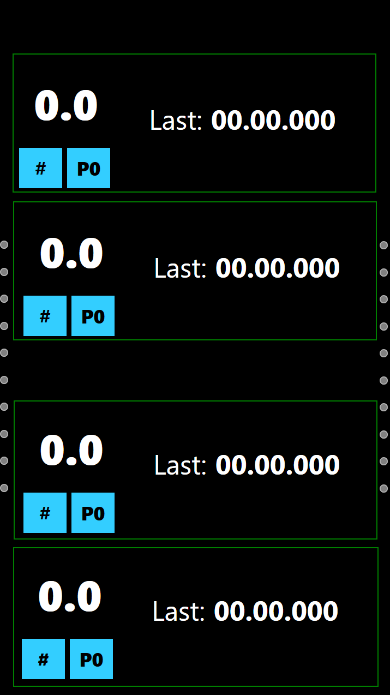

# Zip Formula RacingDash for SimHub

Zip Formula RacingDashは、iRacingでのレース状況をスマートフォンなどに表示するSimHub用ダッシュボードです。

## ダッシュボードの表示

スマートフォンでの使用を想定した縦型レイアウトです。前後の車両情報を4つのカードで表示します。

各カードには次の情報を表示します。

- **Gap**：対象車両とのギャップ
- **ドライバー名**：最終ラップタイム（Last）の上に表示
- **Last**：対象車両の最終ラップタイム
- **車種**：最終ラップタイム（Last）の下に表示
- **# / P**：車両番号やクラス順位などのポジション情報

ドライバー名と車種をあわせて表示するため、前後を走る車両とドライバーを識別しながら、ギャップやラップタイムを確認できます。

## ダウンロード

[**最新版をダウンロード（ZipFormula-SimHub-Setup.exe）**](https://github.com/ryu-mizushima/zipformula-iracingdash-phone/releases/latest/download/ZipFormula-SimHub-Setup.exe)

## インストール方法

1. 上のリンクからインストーラーをダウンロードします。
2. SimHubを終了します。
3. `ZipFormula-SimHub-Setup.exe` を実行します。
4. インストール完了後、SimHubを起動します。
5. Dash Studioを開き、**Import Dashboard** を選択します。
6. ドキュメント内の `Zip Formula\SimHub Dashboard` フォルダーにある `.simhubdash` ファイルを選択してインポートします。

**重要：** インストーラーはダッシュボードファイルを配置しますが、SimHubへの登録は自動では行いません。必ずDash Studioからインポートしてください。

## アンインストール

Windowsの「インストールされているアプリ」からZip Formula SimHub Dashboardをアンインストールできます。

インストーラーが配置したダッシュボードやライセンスファイルは、ドキュメント内に残ります。不要な場合は手動で削除してください。

インストール前から同名のPostItNoteRacingプラグインファイルが存在した場合、アンインストール時にバックアップから復元します。

## ライセンス

Zip Formulaのライセンスはリポジトリ内のLICENSEファイルを参照してください。同梱のPostItNoteRacingはMIT Licenseで提供されています。
